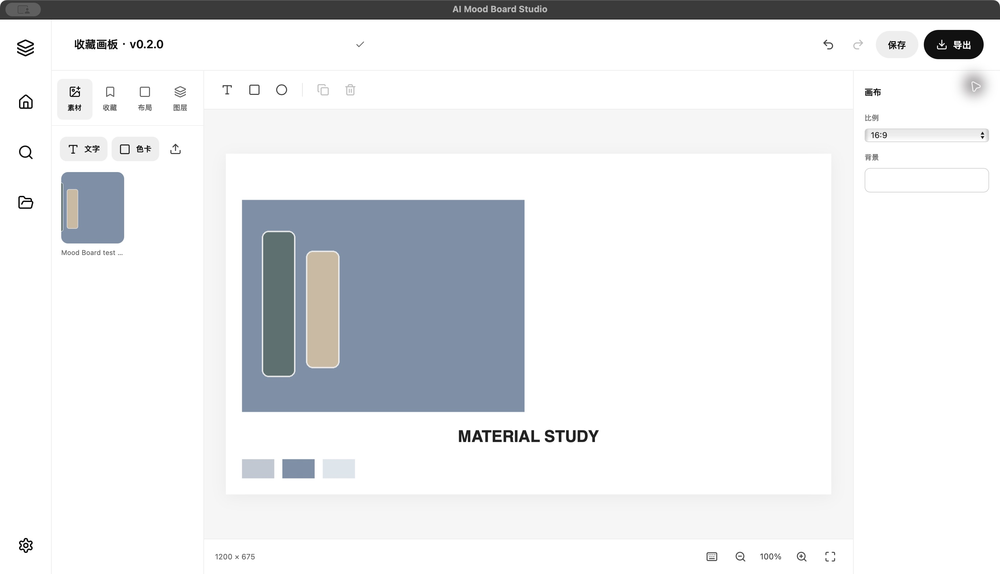

<div align="center">


**发现灵感，收藏线索，组合成你的下一张 Mood Board。**

A local-first visual research workspace with editable mood boards.

[下载 macOS 预览版](https://github.com/t0mAto1104/ai-moodboard-studio/releases/latest) · [使用指南](docs/user-guide.md) · [English](README.en.md) · [版本记录](CHANGELOG.md)

</div>



AI Mood Board Studio 将图片检索、标签收藏、本地视觉排序和可编辑画布放在同一个纯白工作区。核心流程在本机运行；云端大语言模型是可选项。

> **0.1.2 预览版** · Apple Silicon Mac · 安装包约 316 MB · 不含视觉模型、开发者密钥或用户数据 · 尚未完成 Apple Developer ID 签名和公证。

## 可以做什么

- **搜索灵感**：中文 / 英文需求，生成可修改的检索计划，聚合公开图库。
- **整理收藏**：自定义标签、多标签分组和未分组收藏，保留作者与原始来源。
- **视觉筛选**：可连接 SigLIP 2，在获准素材上分析语义、色彩、质量与重复度。
- **编辑画布**：Editorial Grid、Material Board、Creative Collage；拖动、缩放、替换、色卡和文字。
- **本地保存**：项目、收藏和编辑状态存入 SQLite，重新启动后继续编辑。
- **合规输出**：许可满足要求时导出 PNG / PDF，并附署名和许可清单。

搜索、单张下载、AI 分析与拼贴导出分别检查权限；搜索得到图片不代表可以任意使用。

## 下载与安装

1. 前往 [Releases](https://github.com/t0mAto1104/ai-moodboard-studio/releases/latest)，下载 `.dmg`。
2. 打开镜像，将 **AI Mood Board Studio** 拖入 **Applications**。
3. 启动即可使用基础功能，按需配置图库密钥、云端 AI 和视觉模型。

| 项目 | 当前状态 |
| --- | --- |
| 安装包 | macOS / Apple Silicon（M 系列）；暂无 Intel / Windows 包 |
| 系统 | 目标 macOS 14+；实际验证 macOS 15.8.1 / M3 |
| 运行环境 | 已包含，无需另行安装 Python / Node |
| 视觉模型 | 不包含，不自动下载；缺少时使用基础排序 |
| Apple 签名 | ad-hoc 签名，尚未 Developer ID 签名或公证 |

若 macOS 阻止打开，先确认来源，再按系统提示处理；不要关闭全局安全防护。正式分发仍需完成签名、公证及其他电脑验证。[安装与排错](docs/user-guide.md)

## 第一次使用

**无密钥演示**：设置 → 开启「演示素材」，搜索时仅选择该来源 → 输入「简约冷色金属与磨砂玻璃」→ 收藏或创建画布 → 编辑 → 保存 / 导出。

演示素材是程序绘制的几何色彩研究图，用于验证流程，并非真实图库照片，也不是 AI 生成的不可编辑拼贴。真实素材请切换图库来源。[完整操作指南](docs/user-guide.md)

## AI 如何参与

| 任务 | 执行方式 |
| --- | --- |
| 基础中英文关键词解析 | 本机规则，无需密钥 |
| 增强自然语言检索计划 | 可选云端 LLM API / LiteLLM，自带密钥 |
| 图像 / 文本编码、二次排序 | 可选本机 SigLIP 2，需单独模型 |
| 颜色、去重、组合选择、布局 | 本机算法 |

不安装 Ollama，不运行本地 LLM。支持 OpenAI、Anthropic、Gemini、DeepSeek、Qwen、OpenRouter 和自定义 OpenAI-compatible API；模型 ID 可查询或手动填写。密钥由后端保存到系统钥匙串，不写入浏览器持久存储、Git 或项目导出。

视觉模型：`google/siglip2-base-patch16-224`，revision `75de2d55ec2d0b4efc50b3e9ad70dba96a7b2fa2`，768 维。自动检测 CUDA → MPS → CPU。在设置中选择模型目录，可使用外接盘，不会复制权重到内部磁盘。[模型准备与连接](docs/model-setup.md)

远程视觉分析需要读取图片字节，当前在内存处理，不写图片文件缓存；仍需具备对应来源的分析权限。Unsplash 的本地 AI 分析需另行确认授权，普通 API Key 不自动提供该权限。

## 素材来源

| 来源 | 配置与范围 |
| --- | --- |
| Openverse | 无需 Key；检索 / 参考，索引许可不视为已核实 |
| Art Institute of Chicago / The Met | 无需 Key；核实公有领域状态后按权限处理，受上游可用性影响 |
| Unsplash | 自带 Access Key；官方热链接、署名、参考板、下载事件上报；分析需额外授权；符合许可的拼贴可导出 |
| Pixabay | 自带 Key；搜索预览和按规则单张下载；组合创作可导出，画布预览使用本地副本 |
| 用户上传 / 演示素材 | 用户确认使用权 / 原创程序测试图，支持相应编辑导出流程 |

没有接入或抓取 Pinterest。[素材许可](docs/licenses.md) · [收藏与下载](docs/library-and-downloads.md)

## 从源码运行

已验证 Python 3.12 / macOS arm64。Node 需满足 Vite 7：`^20.19.0 || >=22.12.0`。直接依赖已固定，其他平台尚未全面验证。

```sh
git clone https://github.com/t0mAto1104/ai-moodboard-studio.git
cd ai-moodboard-studio
python3.12 -m venv .venv
.venv/bin/python -m pip install -r requirements-tested.txt
npm --prefix apps/web ci
npm --prefix apps/web run build
bash scripts/start.sh
```

打开 <http://127.0.0.1:8765>，`Ctrl+C` 停止。启动脚本先迁移数据库，只监听本机。兼容旧开发环境的父目录 `.venv`，也可通过 `MOODBOARD_PYTHON` 指定解释器。

```sh
# 可选，连接现有模型，不会自动下载
export SIGLIP_MODEL_DIR='/Volumes/YOUR_DISK/AI_Models/siglip2-base-patch16-224'
export MOODBOARD_DATA_DIR='/absolute/path/to/moodboard-data'
bash scripts/start.sh
```

`.env.example` 仅供参考，程序不会自动加载 `.env`。桌面数据默认 `~/Library/Application Support/AI Mood Board Studio`，源码版默认 `.local/`；两者使用独立钥匙串服务，不自动迁移项目和密钥。

## 验证与开发

```sh
bash scripts/test.sh
# 可选：必须实际加载本地模型，降级会使测试失败
.venv/bin/python scripts/smoke.py --vision --output /tmp/moodboard-vision.json
```

已记录 **67 项后端、11 项前端测试通过**，并实际验证生产构建、独立 `.app` 启停、只读 DMG 搬移运行、收藏、项目重开、PNG/PDF 与署名导出，以及外接模型 CPU / MPS 编码。这不代表所有电脑、上游 API 或万张图片性能已经验证。

| 文档 | 内容 |
| --- | --- |
| [使用指南](docs/user-guide.md) | 搜索、收藏、编辑、导出与排错 |
| [模型准备](docs/model-setup.md) | 固定版本、外接目录、离线加载 |
| [架构](docs/architecture.md) / [API](docs/api.md) | 模块与接口，运行后也可访问 `/docs` |
| [验证范围](docs/validation.md) / [性能](docs/performance.md) | 测试命令和测量限制 |
| [桌面构建](docs/desktop-packaging.md) | 打包、审计和签名状态 |
| [已知限制](docs/known-limitations.md) / [贡献指南](CONTRIBUTING.md) | 未完成事项与开发约定 |

## 权利与许可

本仓库暂未指定应用源码的开源许可证；公开可阅读不等于授予复制、修改或再分发许可。第三方依赖、模型和图库素材各自保留其许可条件。[权利说明](NOTICE.md)
